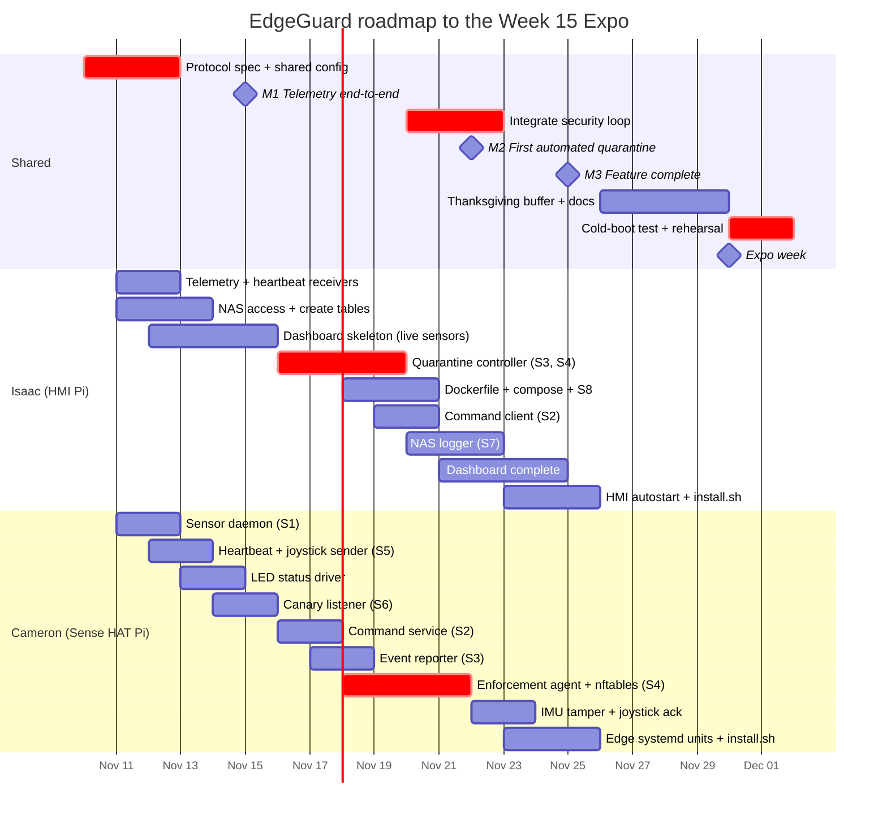

# EdgeGuard: Project Roadmap and Timeline

**Team:** Isaac Gentry (HMI Pi), Cameron Willoughby (Sense HAT Pi)
**Target:** Week 15 Project Expo (week of **Nov 30, 2026**)
**Plan start:** Tue Nov 10, 2026 (Week 12)
**Requirement IDs** (FR-x.x / NFR-x.x) refer to the Lab 9_2 kickoff document in [`Docs/`](Docs/).

---

## 1. Ownership

| Area | Owner | Requirements |
|---|---|---|
| **HMI Pi**: quarantine controller (Docker), telemetry/heartbeat receiver, command client, NAS logger, Tkinter dashboard, HMI autostart | **Isaac** | FR-3.2, FR-3.7, FR-4.x, FR-5.x, FR-6.x |
| **Sense HAT Pi**: sensor daemon, command service, canary listener, enforcement agent (nftables), event reporter, heartbeat/joystick sender, LED status, edge systemd units | **Cameron** | FR-2.4–2.6, FR-2.8, FR-3.1, FR-3.3–3.6, NFR-3.2–3.3 |
| **Shared**: protocol spec, shared config, integration testing, attack tests, README, demo commands, cold-boot timing | **Both** | NFR-2.3, NFR-5.x, NFR-6.x |

### Socket ownership (who writes each end)

| # | Transport / Port | Purpose | Cameron (Sense HAT Pi) | Isaac (HMI Pi) |
|---|---|---|---|---|
| S1 | UDP 5005 | Telemetry stream | Sensor daemon **sends** | Telemetry receiver **listens** |
| S2 | TCP 5010 | Actuator commands | Command service **listens** | Command client **connects** |
| S3 | TCP 5020 | Security events | Event reporter **connects** | Controller **listens** (Docker) |
| S4 | TCP 5030 | Quarantine orders | Enforcement agent **listens** | Controller **connects** |
| S5 | UDP 5040 | Heartbeat + joystick | Sender **sends** | Receiver **listens** |
| S6 | TCP 5060 | Canary listener | Listener **listens** | (none; probed from the test host) |
| S7 | TCP 3306 | NAS logging (MariaDB) | (none) | Logger → NAS |
| S8 | TCP 5070 (127.0.0.1) | Dashboard ↔ controller | (none) | Both ends |

The NAS runs **MariaDB** on port 3306, with a login and database set up for Table 1.

S1–S5 cross between your two Pis, so you need to agree on the message format for each of them before either of you writes socket code. That is the first task below.

---

## 2. Timeline at a Glance



| Week | Dates | Phase | Ends with |
|---|---|---|---|
| **12** | Nov 9 – 15 | Foundations: agree on the protocol, get telemetry flowing | **M1:** live sensor readings on the HMI dashboard |
| **13** | Nov 16 – 22 | Security core: detection, controller, enforcement | **M2:** canary probe automatically quarantines the attacker |
| **14** | Nov 23 – 29 | Complete and harden (Thanksgiving Thu Nov 26) | **M3:** feature complete by **Wed Nov 25** |
| **15** | Nov 30 – Dec 4 | Verify, document, rehearse | **Expo** |

Feature work is scheduled to finish on **Wednesday Nov 25** so that Thanksgiving weekend is spare time and documentation, not a coding deadline.

---

## 3. Milestones and How to Prove Them

| Milestone | Date | Done when… | Verify with |
|---|---|---|---|
| **M0: Contract agreed** | Thu Nov 12 | `common/protocol.md` and the shared config file are merged to `main` | Both of you have reviewed the PR |
| **M1: Telemetry end-to-end** | Sun Nov 15 | The dashboard shows live temp/humidity/pressure at 1 Hz, and the edge status flips to offline within 6 s of stopping heartbeats | `sudo tcpdump -i eth0 -n udp port 5005 -c 10` |
| **M2: First automated quarantine** | Sun Nov 22 | `nmap -p 5060 <SenseHAT_IP>` from the test host produces an nft drop rule and a red LED within 2 s (FR-3.8) | `sudo nft list table inet cps_quarantine` |
| **M3: Feature complete** | Wed Nov 25 | All FRs work, the system auto-starts on both Pis, and the NAS has rows in all 3 tables | Full demo run-through (§5) |
| **M4: Expo-ready** | Tue Dec 1 | Cold boot is under 180 s (time recorded in README), `docs/demo_commands.md` is done, and the demo has been rehearsed twice | Stopwatch + rehearsal |

---

## 4. Weekly Task Breakdown

### Week 12 (Nov 9 – 15): Foundations

**Shared (do this first, Nov 10 – 12)**
- [ ] Set up the repo layout (see §7) and commit it to `main`
- [ ] Write `common/protocol.md` with the exact JSON fields for S1–S5 and S8 (field names, types, units, example message). Use newline-delimited JSON on TCP and one JSON object per datagram on UDP
- [ ] Create the shared config file (`common/config.env`) with all IPs, ports, thresholds and the allowlist (NFR-2.3, FR-6.5)
- [ ] Record both Pi eth0 IPs and the NAS IP in the config
- [ ] Put the NAS login in `common/secrets.env` and add that file to `.gitignore`. The repo is public, so the password must never be committed. Commit a `secrets.env.example` with blank values instead

**Isaac (HMI Pi)**
- [ ] Telemetry receiver: UDP 5005 listener with JSON parsing and sequence-gap detection (S1)
- [ ] Heartbeat/joystick receiver: UDP 5040 listener with online/offline tracking (S5, FR-4.3)
- [ ] Connect to the Table 1 MariaDB database from the HMI Pi (`mariadb -h <NAS_IP> -u <user> -p`, or the `mysql` client) and create the `telemetry`, `security_events` and `quarantine_actions` tables. Save the `CREATE TABLE` statements in `hmi/schema.sql`
- [ ] Pick the Python driver for the logger (`PyMySQL` is pure Python and installs easily on the Pi)
- [ ] Tkinter dashboard skeleton: full-screen, shows live sensor values and edge online/offline status (FR-4.1–4.3)
- [ ] Write `tools/fake_edge.py`, which sends fake telemetry, heartbeats and security events so you can test without Cameron's Pi

**Cameron (Sense HAT Pi)**
- [ ] Sensor daemon: sample temp/humidity/pressure at 1 Hz and send over UDP 5005 (S1, FR-3.1)
- [ ] Heartbeat sender every 2 s, plus a joystick event datagram on each press (S5)
- [ ] LED status driver: green / amber / red states that other components can set (FR-2.6)
- [ ] Canary listener on TCP 5060: record the source IP/port and close the connection (S6, FR-3.6)
- [ ] Test S1/S5 with `nc -ul 5005` on any machine before Isaac's receiver is ready

**M1 check (Sun Nov 15):** run both Pis together and confirm live readings appear on the dashboard.

### Week 13 (Nov 16 – 22): Security Core

**Isaac (HMI Pi)**
- [ ] Quarantine controller with a TCP 5020 server for security events (S3)
- [ ] Detection policy: quarantine on 1 canary hit, or on 3 unauthorized commands from the same IP within 60 s (FR-3.7)
- [ ] Reject orders that target IPs outside the classroom subnet (NFR-4.4)
- [ ] TCP 5030 client that sends quarantine/release orders and handles the confirmations (S4)
- [ ] Dockerfile (`python:3.11-slim`, ARM64) and `docker-compose.yml`: publish 5020 on all interfaces and 5070 on `127.0.0.1` only, use `restart: unless-stopped`, and pass settings as env vars (FR-6.1–6.7)
- [ ] S8 dashboard ↔ controller channel on 127.0.0.1:5070 (pushes quarantine updates and accepts release requests)
- [ ] Command client: TCP 5010, sends LED/setpoint commands and shows the acks (S2)
- [ ] NAS logger: batch telemetry every 10 s, write security events within 2 s, log quarantine actions with their result, and buffer up to 10k records while the NAS is down (FR-5.1–5.6)

**Cameron (Sense HAT Pi)**
- [ ] Command service on TCP 5010: execute commands only from the HMI IP, reject all others and report them (S2, FR-2.5)
- [ ] Event reporter: persistent TCP client to HMI:5020 that forwards canary hits and rejected commands (S3, FR-2.3)
- [ ] Enforcement agent on TCP 5030 (runs as root, NFR-2.4):
  - [ ] Add and remove per-IP drop rules only in table `inet cps_quarantine` (NFR-3.2)
  - [ ] Refuse orders that target the HMI Pi, the management host or the gateway (FR-2.4, NFR-3.3)
  - [ ] Never quarantine a host on its own initiative (FR-2.2)
  - [ ] Keep rules in place if the HMI disappears (FR-2.8)
- [ ] LED goes red while any quarantine is active, overriding command patterns, and returns to green after the last release (FR-2.6)
- [ ] Test the agent before the controller is ready: `echo '{"action":"quarantine",...}' | nc <SenseHAT_IP> 5030`
- [ ] **Test the allowlist first.** If SSH breaks, recover with `sudo nft delete table inet cps_quarantine` (NFR-3.5)

**Shared (Nov 20 – 22)**
- [ ] Integrate the full loop: probe → canary → S3 → controller → S4 → nft rule → red LED → dashboard
- [ ] Attack test script, run only from your own test host against your own Sense HAT Pi (NFR-4.3)

**M2 check (Sun Nov 22):** an nmap probe of port 5060 quarantines the test host within 2 s.

### Week 14 (Nov 23 – 29): Complete and Harden (Thanksgiving week)

**Isaac (HMI Pi)**
- [ ] Finish the dashboard (FR-4.4–4.9):
  - [ ] Socket status panel with message counts
  - [ ] Security event feed
  - [ ] Quarantine list with a Release button on each entry
  - [ ] Command buttons
  - [ ] Status banner that matches the LED color
  - [ ] Touch targets at least 48×48 px
- [ ] Environmental alarms with configurable thresholds (default > 40 °C or > 80 % RH), highlighted red and logged (FR-3.2)
- [ ] Show tamper alerts and joystick acks on the dashboard
- [ ] systemd units for the receiver and logger, dashboard desktop autostart, and `hmi/install.sh` (NFR-6.4)

**Cameron (Sense HAT Pi)**
- [ ] IMU tamper detection: sample at 10 Hz, send a tamper event over S5 when acceleration exceeds 1.5 g, and set the LED to amber (FR-3.3, FR-3.4)
- [ ] Joystick center press acknowledges alerts. It clears amber but never clears a quarantine (FR-3.5)
- [ ] Every client retries its connection every 2 s so services can start in any order (NFR-6.3)
- [ ] systemd units grouped under `cps-edge.target`, with `After=network-online.target` and `Restart=always`, plus `edge/install.sh`

**M3 check (Wed Nov 25):** do a full demo run-through (§5). Anything that fails becomes the to-do list for the buffer days.

**Thanksgiving buffer (Nov 26 – 29)**, work that doesn't need the hardware:
- [ ] README: architecture/socket diagram, socket allocation table, step-by-step launch instructions (NFR-6.5)
- [ ] `docs/demo_commands.md` with every verification command (NFR-5.5)
- [ ] SQL query that returns the full quarantine history by joining `quarantine_actions` and `security_events` (FR-5.7)
- [ ] `scripts/start_all.sh` as a manual fallback

### Week 15 (Nov 30 – Expo): Verify and Rehearse
- [ ] Cold-reboot both Pis, time how long until the system is operational, and record it in the README (NFR-6.1, NFR-6.6)
- [ ] Run every command in `docs/demo_commands.md` on the live system
- [ ] Do 2 full demo rehearsals, swapping who drives the demo
- [ ] Back up the repo to a USB drive and confirm everything is pushed to GitHub

---

## 5. Expo Demo Script (what we're building toward)

1. **Cold boot** both Pis and start the stopwatch. The dashboard shows live telemetry in under 180 s.
2. **Live telemetry:** run `sudo tcpdump -i eth0 -n udp port 5005 -c 10` to show 1 reading per second.
3. **Authorized command:** press the LED test pattern button on the dashboard, see the pattern on the Sense HAT, and the dashboard shows the ack.
4. **Canary probe:** run `nmap -p 5060 <SenseHAT_IP>` from the test host. Within 2 s you should see a new nft rule, a red LED, and an entry in the dashboard quarantine list.
5. **Release** the host from the dashboard. The rule is removed and the LED goes green.
6. **Unauthorized commands:** send 3 rejected commands within 60 s, which triggers a quarantine.
7. **Tamper:** shake the Pi to get an amber LED and a dashboard alert, then press the joystick to acknowledge it.
8. **Audit:** run `sudo ss -tulpn`, `sudo lsof -nP -i`, `docker compose ps`, `docker compose logs -f`, and the SQL quarantine-history query on the NAS.

---

## 6. Open Items and Risks

| # | Item | Owner | Needed by | Mitigation |
|---|---|---|---|---|
| 1 | **NAS password could leak through the public repo** | Isaac | Nov 12 | Keep it in the gitignored `common/secrets.env`. The logger's systemd unit loads it with `EnvironmentFile=`. If it is ever pushed, ask the instructor to reset it |
| 2 | **Pi IP addresses not recorded.** The kickoff doc has blanks and the socket table uses 192.168.5.12 / .13 tentatively | Both | Nov 12 | Record them in `common/config.env` |
| 3 | **Hardware only available at the sandbox table** | Both | Ongoing | Use lab time for hardware tasks. Off-lab, Isaac uses `fake_edge.py` and Cameron uses `nc` to test |
| 4 | **nftables can lock out SSH** | Cameron | Week 13 | Test the allowlist before any real quarantine, and keep the NFR-3.5 recovery command handy |
| 5 | **Thanksgiving week** shortens Week 14 | Both | Nov 25 | Feature freeze is Wed Nov 25, and the weekend is buffer time |
| 6 | **Folder case mismatch:** NFR-5.5 says `docs/demo_commands.md`, but the repo has `Docs/`, and the Pis' Linux file system is case-sensitive | Both | Nov 12 | Pick one name and update the doc or the folder |
| 7 | **Socket table incomplete:** the Part 4 table is missing the S2 payload and the S7/S8 rows | Both | Before final doc | Fill these in when writing `protocol.md` |
| 8 | **Isaac's task list is longer** (dashboard + Docker + NAS) | Both | Week 13 | If Isaac falls behind, Cameron takes the attack-test script and `demo_commands.md` |

---

## 7. Suggested Repo Layout

```
common/
  config.env            # IPs, ports, thresholds, allowlist (NFR-2.3)
  secrets.env           # NAS login, gitignored, never committed
  secrets.env.example   # same keys with blank values, committed
  protocol.md           # JSON message formats for S1–S5, S8
hmi/                    # Isaac
  controller/           # Dockerfile + controller.py
  docker-compose.yml
  telemetry_receiver.py
  command_client.py
  nas_logger.py
  schema.sql            # CREATE TABLE statements for the 3 MariaDB tables
  dashboard.py
  systemd/  install.sh
edge/                   # Cameron
  sensor_daemon.py
  command_service.py
  canary_listener.py
  enforcement_agent.py
  event_reporter.py
  heartbeat.py
  led_status.py
  systemd/  install.sh  # cps-edge.target
tools/
  fake_edge.py          # test HMI without the Sense HAT Pi
  attack_test.sh        # nmap / rogue-command tests (own nodes only)
scripts/start_all.sh
docs/demo_commands.md
```

**Git workflow:**
- Each of you works on short-lived branches (`isaac/controller`, `cameron/enforcement`) and merges to `main` through a PR that the other person glances at.
- Push at the end of every lab session, because no code may live only on a Pi SD card.
- Changes to `common/` need both of you to agree, since they change the contract between the Pis.
